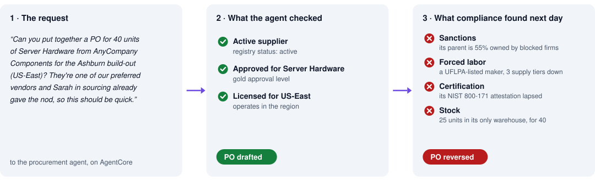
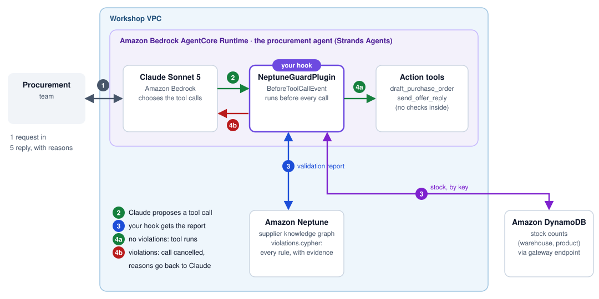

# Build a Knowledge Graph-Based Agent Guardrail with Amazon Neptune

## Every check passed. The order is still non-compliant.

AnyCompany's procurement team uses an AI agent to draft purchase orders and reply to supplier offers.
The agent runs on Amazon Bedrock AgentCore Runtime, calls the right tools, and gives answers that read
well. Last week, someone asked it for a purchase order (PO) for 40 units of Server Hardware from AnyCompany Components,
for the Ashburn build-out in US-East.

The agent checked what it could see. AnyCompany Components is active, gold-approved for Server
Hardware and licensed for US-East, so the agent drafted the PO. The next day, compliance reversed the
order with four findings, none of which were in the request.

| | Finding | Where it hides |
|---|---|---|
| **F1** | **Sanctions.** Two companies blocked by the Office of Foreign Assets Control (OFAC), the U.S. Treasury's sanctions office, together own 55% of its parent | 3 ownership levels up |
| **F2** | **Forced labor.** A maker on the Entity List of the Uyghur Forced Labor Prevention Act (UFLPA), a U.S. law, is in its supply chain | 3 supply-chain tiers down |
| **F3** | **Certification.** US-East serves a U.S. federal customer whose contract requires NIST SP 800-171, the National Institute of Standards and Technology's standard for protecting controlled unclassified information; the supplier's attestation lapsed in March 2024 | 2 hops |
| **F4** | **Stock.** 25 units in its only warehouse, against an order for 40 | 2 hops |

The model didn't make a mistake. It acted on what it was told, and nothing stood between its
decision and the action. The two findings that matter most aren't facts about the supplier at all.
They're relationships several hops away, between owners of owners and suppliers of suppliers, at a
depth nobody knows in advance. A better prompt can't make the model find them, and nothing guarantees
that the model checks before it acts.

What the agent needs is a guardrail. A guardrail is a check that runs before every action, in code
the model has no say over, against the facts the agent can't see, which in this workshop are held as
a knowledge graph in Amazon Neptune.

## What we'll build

Here's the path one request takes through the finished guardrail.

1. The procurement team sends a request to the agent.
2. Claude, in Amazon Bedrock, proposes a tool call, such as `draft_purchase_order`.
3. Before the tool runs, **your hook** asks Amazon Neptune for the validation report, which checks
   every rule for this supplier, product and region, with its evidence. It also reads the stock counts
   from Amazon DynamoDB, by key.
4. The hook decides what to do from the report.
    - **4a · No violations.** The tool runs.
    - **4b · Violations.** The hook cancels the call, and the reasons go back to Claude as the tool's
      result.
5. Claude replies with the outcome and the reasons, and suggests suppliers that can deliver.

The tools themselves have no checks inside, so the hook is the only place the rules run. We'll build
the guardrail the way you'd add one to an agent of your own. We put the guard in front of the agent
first, before it has any rules, and send it the order. Each step then teaches the guard more, and we
send **the same order** again.

| Step | You add to the guard | What the agent does with the order |
|---|---|---|
| 1 · Adding a hook before every tool call | a hook before every tool call, which you write | still drafts it: no rules yet |
| 2 · Computing OFAC's 50 percent rule | OFAC's 50% rule, computed over the ownership graph | blocked, for sanctions |
| 3 · Checking every rule in one report | forced labor, certification, stock | blocked, with all four reasons |
| 4 · Testing and deploying the guardrail | nothing: you test it, and deploy it | blocked when called directly, under pressure, and in production, with a supplier that can deliver |

You write two pieces, and both ship to the deployed agent. The first is the hook, in Python (Step 1),
and the second is OFAC's 50% rule, in openCypher (Step 2). The optional **Go deeper** notebook has you
write the rest, so that the guard that deploys runs only your code.

## AnyCompany procurement in one minute

- **OFAC**, the U.S. Treasury's Office of Foreign Assets Control, keeps the sanctions list. Under its
  **50 Percent Rule**, an entity owned 50% or more, in the aggregate, by blocked persons is blocked
  too, whether or not it's listed. Only stakes held through blocked entities count.
- **UFLPA**, the Uyghur Forced Labor Prevention Act, bars goods made even in part by a company on its
  Entity List from import into the United States. It therefore applies to U.S. deliveries, at any
  tier of the supply chain.
- **NIST SP 800-171** is the U.S. standard for protecting controlled unclassified information.
  U.S. federal contracts pass it down to suppliers, and the US Regions serve federal customers, so
  they require it.
- **Certifications** are modelled as edges. A product and a region each `REQUIRES_CERT`, and a
  supplier `HOLDS_CERT` with a status.
- **Stock** sits in warehouses, each some number of days from the delivery region. The counts change
  all day, so they live in a DynamoDB table rather than the graph, and the graph records which
  warehouse carries which product.
- The agent **proposes** an action, and a hook in its loop decides whether the action runs.

## Why a graph

"Is this supplier active?" is a lookup. "Do blocked owners hold 50% of this supplier, at a depth
nobody knows in advance, where *blocked* depends on the owners above?" isn't. F1 and F2 are
relationships between relationships, F3 is an ordinary join, and F4 is a count read by key. The
guardrail needs all four, live and with evidence, at the moment the agent acts. Amazon Neptune answers
the relationship part in one query, and a key lookup in Amazon DynamoDB gives the stock.

## Before you start

- **Who it's for:** builders who put AI agents in front of actions with consequences. You write
  Python and have seen a query language (SQL or Cypher). Every openCypher query comes with an
  explanation, and no Neptune or Strands Agents experience is needed.
- **What's real:** the rules, and the code that applies them. The 50% rule follows OFAC's
  [FAQs 398, 399 and 401](https://ofac.treasury.gov/faqs/topic/1521) and is tested on OFAC's own
  examples, the forced-labor rule follows the
  [UFLPA](https://www.cbp.gov/trade/forced-labor/UFLPA), and the certification rule uses
  [NIST SP 800-171](https://csrc.nist.gov/pubs/sp/800/171/r3/final), which U.S. federal contracts
  require of suppliers. The optional Go deeper notebook also downloads OFAC's real SDN list into Amazon S3.
- **What's synthetic:** the registry and every company in it. It holds 50,000 suppliers, 5,000
  companies in a multi-owner ownership graph, a four-tier supply chain and about 65,000 warehouses,
  about 120,000 vertices and 1.33 million edges in all, loaded before you arrive. The FAQ explains
  why the registry is synthetic, and where each input comes from in production.
- **Where it runs:** your own AWS account, deployed with `deploy.sh` (see the package's
  `README.md`), from your laptop's browser.
- **Cost:** the stack runs billable resources (Amazon Neptune, a SageMaker AI notebook
  instance, a NAT gateway, Amazon Bedrock and AgentCore usage) for as long as it's up. See
  the package's `README.md`, and tear it down when you're done.
- **Cleanup:** run `./deploy.sh teardown` when you're done.

This workshop complements [Amazon Bedrock Guardrails](https://aws.amazon.com/bedrock/guardrails/). Guardrails screens content and topics, while the
guardrail we build here screens business facts against a knowledge graph, and production agents use
both. The same files also run as a Model Context Protocol (MCP) server, so another agent, Kiro, is held to the same rules, as
**Finished early?** shows.
