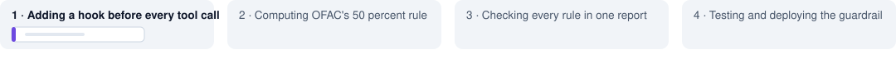

# 1 · Adding a hook before every tool call



> **You can stay in JupyterLab.**
>
> Everything needed to run this step is in notebook 1.1, including what to do if a cell fails. This
> page adds background.

In this step, we'll put a guard in front of the agent. The guard is a hook, which you write, that
runs before every tool call and can cancel it. It has no rules yet, so when we send the same order
through it, we'll see what the guard does before it knows anything. This step takes about 10
minutes.

## The hook

Strands Agents, the SDK the agent is built on, fires a `BeforeToolCallEvent` before every tool call
and runs every hook registered for it. If a hook sets `event.cancel_tool` to a string, the tool never
runs, and the string becomes the tool's result, which the model reads as if the tool had answered.
The model can't skip the hook, because running it isn't the model's choice.

The hook calls three functions in `guard_rules.py`, which are given for now.

| Function | What it answers |
|---|---|
| `should_check(tool, args)` | whether the call commits AnyCompany to something, as every PO does |
| `run_report(args)` | the validation report for the order, with one row per broken rule; it raises if the report can't run |
| `block_message(supplier, product, region, report)` | `None` if nothing blocks; otherwise the text the model should read, starting `BLOCKED`. |

## Run it

Carry on in **`1.1 - Adding a hook before every tool call.ipynb`**, after the Start section.

1. In **Cell 1.1 · ✏️ The hook**, write `before_tool`, which takes about 8 lines, and run the cell.
   A solution you can reveal sits under it. If a ✏️ step is still missing, the cell says so in red,
   because saving the starter unchanged isn't a pass.
2. Run **Cell 1.2 · Check the hook**. Before you run it, think about which case would fail if the
   `try` were missing.
3. Run **Cell 1.3 · Send the order through your guard**. Before you run it, think about what the
   agent will do, given that the guard has no rules yet.

## What the hook looks like

The hook is the code you write in Cell 1.1, so the finished version is collapsed here. Open it after
you've written your own, or if you're stuck.

<details>
<summary>Show the finished hook</summary>

```python
@hook
def before_tool(self, event: BeforeToolCallEvent) -> None:
    tool = event.tool_use.get("name", "")
    args = event.tool_use.get("input") or {}
    if not self.rules.should_check(tool, args):
        return                     # not a consequential call: let it run
    try:
        report = self.rules.run_report(args)
    except Exception as e:
        # Fail closed: an action that can't be proven valid doesn't happen.
        event.cancel_tool = f"BLOCKED: could not validate this action against Neptune ({e})"
        return
    message = self.rules.block_message(args.get("supplier_name"), args.get("product_name"),
                                       args.get("region_name"), report)
    if message:
        event.cancel_tool = message
```

</details>

Cell 1.2 tests the hook with `FakeRules`, a stand-in for `guard_rules.py` whose report the test
controls, by calling the PO tool directly on a real agent. A report with a violation must block, an
empty report must let the PO run, a report that raises must block, and a call that needs no check must
run without a report being requested.

Cell 1.3 puts the hook in front of the agent. These are the same lines that run again in Steps 2 and
3, where only the installed rules change.

```python
install_rules([])                                                         # no rules yet
agent = build_agent(guard=NeptuneGuardPlugin(rules=reload(guard_rules)))  # the same agent, plus your hook
reply = ask(agent, HEADLINE)                                              # the original request
record("Step 1", reply)                                                   # what happened to the PO
```

## What we found

### The hook must fail closed

Without the `try`, a report that can't run lets the PO through. The case that matters most in
production, when the graph is unreachable, is exactly the one a happy-path test never exercises.

### A guard with no rules lets it through

In Cell 1.3, the hook ran before the tool call, got an empty report, and the PO was drafted again. A
guard is only as good as its rules, and those rules need the facts that live in the graph, which is
where Step 2 begins.

> **In your system.**
>
> Put a hook on every tool that commits your business to something, before you have a single rule, so
> that there's exactly one place where every rule runs. Make the hook fail closed, and return the
> reasons as the tool's result, so the model can explain the decision and move on.

> **Check.**
>
> Cell 1.2 shows **PASS** on all four cases, and Cell 1.3 ends with `Step 1   drafted the PO`. Go to
> **2 · Computing OFAC's 50 percent rule**.

<details>
<summary>A FAIL in Cell 1.2, or out of time?</summary>

If the check fails, Cell 1.2 keeps your file as `neptune_guard.py.mine` and loads the reference. To
skip writing the hook, run `catch_up("hook")` in a new cell.

After a kernel restart, run **Cell 0.1 · Connect** again first.

</details>
