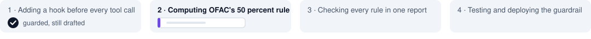
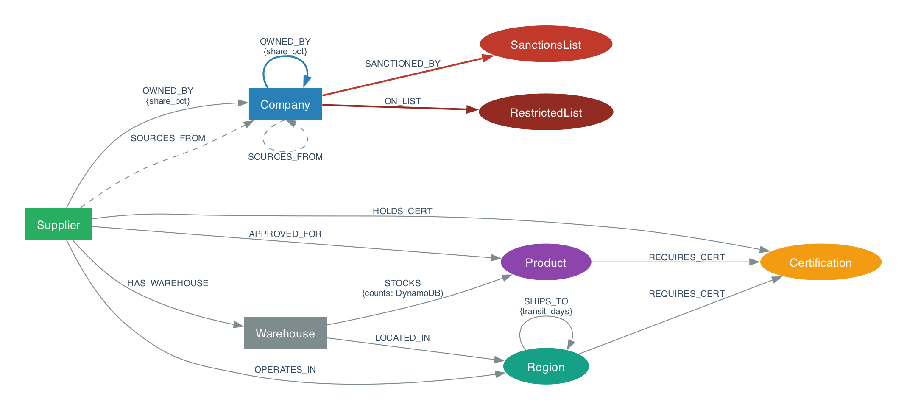
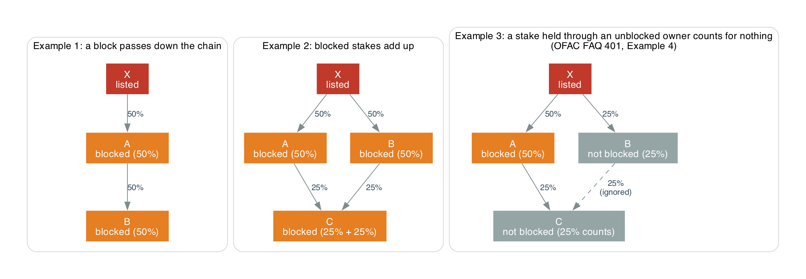

# 2 · Computing OFAC's 50 percent rule



> **You can stay in JupyterLab.**
>
> Everything needed to run this step is in notebook 1.2, including what to do if a cell fails. This
> page adds background.

In this step, we'll take on the hardest of the four findings, sanctions. We'll look at the facts the
agent couldn't see, find out why a simple lookup can't answer the question, and then write OFAC's 50%
rule as a query and give it to the guard. This step takes about 15 minutes.

## The graph



| From | Edge | To | Edge carries | Used for |
|---|---|---|---|---|
| Supplier, Company | `OWNED_BY` | Company | `share_pct` | sanctions |
| Company | `SANCTIONED_BY` | SanctionsList | `listed_date`, `program` | sanctions |
| Supplier, Company | `SOURCES_FROM` | Company | | forced labour |
| Company | `ON_LIST` | RestrictedList | `listed_date` | forced labour |
| Product, Region | `REQUIRES_CERT` | Certification | | certification |
| Supplier | `HOLDS_CERT` | Certification | `cert_status`, `expiry_date` | certification |
| Supplier | `HAS_WAREHOUSE` | Warehouse | | stock |
| Warehouse | `STOCKS` | Product | none (the counts are in DynamoDB) | stock |
| Warehouse | `LOCATED_IN` | Region | | delivery |
| Region | `SHIPS_TO` | Region | `transit_days` | delivery |
| Supplier | `APPROVED_FOR` | Product | `approval_status`, `approval_level` | the basic checks |
| Supplier | `OPERATES_IN` | Region | | the basic checks |

`OWNED_BY` and `SOURCES_FROM` run from the supplier to a `Company` on the first hop, and from one
`Company` to another on every hop after that. A chain of them can therefore be any length, which is
something a table lookup can't follow.

## The question

AnyCompany Components isn't on any sanctions list, so is it sanctioned? A lookup can't tell us, and
the answer has to be **computed**. There are three ways we could approach it.

| Option | What it gives you | What it costs |
|---|---|---|
| **A · Screen the name** against the supplier's direct owners | what most vendor screening does | misses anything two or more levels up |
| **B · Any listed owner upstream** | one walk of any depth | blocks minority stakes that OFAC doesn't block |
| **C · OFAC's 50% rule, computed** | the regulator's answer | has to be computed across the graph, and again whenever the list changes |

OFAC's rule is defined in terms of itself. An entity is blocked when **blocked** owners together hold
50% or more of it, and an owner can be blocked because of *its* owners. We therefore compute the rule
ahead of time. We start by marking every listed company as blocked, and then repeat a single step
until it blocks nothing new. The guard only has to read the result.

OFAC explains the rule in numbered answers to frequently asked questions, its
[FAQs on the 50 Percent Rule](https://ofac.treasury.gov/faqs/topic/1521). FAQ 399 says that stakes
held by different blocked owners add up, and FAQ 401 works through five ownership examples. The
picture shows three of them, and the check in Cell 2.4 uses FAQ 399 and all five.



> **Think before you look.**
>
> Which of the options block AnyCompany Components? Which of them wrongly block AnyCompany Electronics,
> where a sanctioned firm holds only 20%? Decide before running the cells.

## Run it

Open **`1.2 - Computing OFAC's 50 percent rule.ipynb`**, and run **Cell 2.0 · Connect** first. It connects this
notebook's kernel and shows where the order stands so far. Then:

1. Run **Cell 2.1 · What it couldn't see**, and choose its **Graph** tab.
2. Run **Cell 2.2 · Two simple checks**.
3. In **Cell 2.3 · ✏️ The 50% rule**, write one round of the rule, and run the cell. A solution you
   can reveal sits under it.
4. Run **Cell 2.4 · Run the 50% rule, and check it**. It runs your query until it converges, and
   then checks it against OFAC's six worked examples, FAQ 399 and FAQ 401's Examples 1 to 5. Each
   one is drawn as a small ownership graph, titled with OFAC's number and a line saying what it
   shows, with the entities your query blocked in red and a PASS or FAIL on each.
5. Run **Cell 2.5 · The rule's result, in the graph explorer**, and choose its **Graph** tab. Blocked entities
   are in one colour, with the stakes on the edges. Click a vertex to see its `blocked_share`.
6. Run **Cell 2.6 · Teach it the rule, and send the order**.

## What the cells ran

Cell 2.1 finds the supplier on the order once, by a parameter, and makes two walks from it inside
`CALL { }`. The `*1..` means one or more hops, as far as the chain goes, so the query never has to
say how deep a particular chain is.

> **Unbounded walks in production.**
>
> The workshop's walks are unbounded because we know the dataset, whose deepest chain is eight
> ownership hops, and every walk starts from one supplier. In production, an unbounded walk's cost
> depends on the data, and a densely connected stretch of graph can multiply the paths it explores.
> Consider an upper bound, such as `*1..12`, chosen from the depth of your own data. A bound also
> changes the answer for any chain deeper than it, so decide what the guard does when a chain reaches
> the bound, for example by blocking the action as unverifiable.

```cypher
// Find the supplier on the order once; both walks start from it
MATCH (s:Supplier {name: $supplier_name})
CALL {
  // Walk 1: up its owners, any number of hops, to the sanctions list
  WITH s
  MATCH p = (s)-[:OWNED_BY*1..]->(:Company)-[:SANCTIONED_BY]->(:SanctionsList)
  RETURN p
  UNION
  // Walk 2: down its supply chain, any number of hops, to the UFLPA list
  WITH s
  MATCH p = (s)-[:SOURCES_FROM*1..]->(:Company)-[:ON_LIST]->(:RestrictedList)
  RETURN p
}
RETURN p
```

The 50% rule sums the stakes held by owners that are already blocked, and blocks any entity where
that sum reaches 50% or more. It's the query you write in Cell 2.3, so the finished version is
collapsed here. Open it after you've written your own, or if you're stuck.

<details>
<summary>Show the finished 50% rule</summary>

```cypher
MATCH (e)-[o:OWNED_BY]->(owner) WHERE owner.blocked = true
WITH e, sum(o.share_pct) AS blocked_share
WHERE blocked_share >= 50 AND coalesce(e.blocked, false) = false
SET e.blocked = true, e.blocked_share = blocked_share
RETURN count(e) AS newly_blocked
```

</details>

Cell 2.4 runs the query the way a production system would. It seeds the listed companies, and then
runs one round at a time until a round blocks nothing new.

```python
seed_ownership_rule()                 # every company on the list starts out blocked
rounds = []
for _ in range(25):
    newly_blocked = ownership_round()   # your query, once
    rounds.append(newly_blocked)
    if not newly_blocked:               # nothing new: the fixpoint
        break
```

Cell 2.6 installs two rules in the guard. The first covers the basics (status, approval and region),
and the second covers sanctions, which reads the result of your rule to see whether the supplier, or
anything up its ownership chain, is `blocked`.

## What we found

### The facts that matter are relationships

The graph shows two ownership routes up to the OFAC list, which meet at AnyCompany Components Holdings
BV, with a stake on every edge. It also shows three supply-chain tiers down to a maker on the UFLPA
list. Neither depth is known in advance.

### Derived facts have to be computed

Option A misses AnyCompany Components, and option B also blocks AnyCompany Electronics. The 50% rule
converges in five rounds and matches all six of OFAC's examples. Holdings BV is blocked at 55% (30%
plus 25%), and AnyCompany Electronics is not. A query that sums every stake, without first filtering
on blocked owners, would pass on AnyCompany's data but fail OFAC's Examples 4 and 5, which is why the
check uses the regulator's own examples.

### The guard now blocks the order

With the same request and the same agent, the PO is now blocked, because blocked owners hold 100% of
AnyCompany Components. The model explains the block and offers alternatives. A single rule caught a
problem that no prompt could have found, three ownership levels above the supplier.

> **In your system.**
>
> Keep the relationships your rules follow in a graph, especially those of unknown depth, such as
> ownership, supply, delegation or dependencies. When a fact is derived, like "blocked under the 50%
> rule", compute it whenever its inputs change, and have the guard read the result.

> **In production.**
>
> No regulator offers an API that answers "is this supplier blocked?", because a company blocked
> under the 50% rule isn't on any list. OFAC publishes the SDN list as files on its
> [Sanctions List Service](https://sanctionslist.ofac.treas.gov/), and the
> [Consolidated Screening List](https://www.trade.gov/consolidated-screening-list) combines it with
> other U.S. export and sanctions lists, but neither says who owns whom. Ownership stakes are licensed
> from commercial providers. A production guard downloads the lists on a schedule, matches their
> entries to the licensed ownership data, and reruns the 50% rule from this step whenever either one
> changes. The guard reads the stored result at action time, as yours does, so no action waits on an
> outside service. Cells G.7 and G.8 in Go deeper land the real SDN list in Amazon S3.

> **Check.**
>
> Cell 2.4 shows **PASS** on all six OFAC examples, and Cell 2.6 ends with
> `Step 2   BLOCKED: 1 of 4 problems caught (sanctions)`. Go to **3 · Checking every rule in one report**.

<details>
<summary>A FAIL in Cell 2.4, a reason that says ownership-rule, or out of time?</summary>

Cell 2.4 keeps your query as `queries/ownership_50pct.cypher.mine`, loads the reference, and
recomputes. A reason of `ownership-rule` means the 50% rule hasn't been run against the current list.
In either case, or to skip writing the rule, run this in a new cell:

```python
catch_up("ownership")
```
After a kernel restart, run **Cell 2.0 · Connect** again first.

</details>
