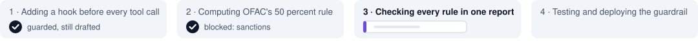

# 3 · Checking every rule in one report



> **You can stay in JupyterLab.**
>
> Everything needed to run this step is in notebook 1.3, including what to do if a cell fails. This
> page adds background.

In Step 2, one rule caught one of the order's four problems. In this step, we'll give the guard every
rule. Each rule has the same shape, a query that returns a row with its evidence when the rule is
broken. We'll read one rule in full, look at the one fact that deliberately isn't kept in the graph,
and then install every rule in the guard and send the order again. This step takes about 12 minutes.

## Run it

Open **`1.3 - Checking every rule in one report.ipynb`**, and run **Cell 3.0 · Connect** first. It connects this
notebook's kernel and shows where the order stands so far. Then:

1. Run **Cell 3.1 · One rule, as a query**, which runs the UFLPA rule in full, for US-East and for
   EU-Central.
2. Run **Cell 3.2 · Where the stock count lives**.
3. Run **Cell 3.3 · Every rule, in one call**, which installs every rule and runs the report. Under
   the report, the evidence for each finding is drawn as a path from the supplier. The workshop's
   display code draws it from the report's rows, and the caption says so.
4. Run **Cell 3.3a · The same evidence, in Neptune's graph view**, and choose its **Graph** tab. It's
   Neptune's own answer to the same question, drawn by graph-notebook.
5. Run **Cell 3.4 · Send the order**. Before you run it, think about what the agent will say this
   time.
6. Run **Cell 3.5 · The list changes**.

## What the cells ran

Cell 3.1 runs a complete rule. It has a variable-length pattern, a condition, and a row of evidence, and
if no row comes back, the rule holds.

```cypher
MATCH (s:Supplier {name: $supplier_name}), (dest:Region {name: $region_name})
WHERE dest.country = $uflpa_country
MATCH tiers = (s)-[:SOURCES_FROM*1..]->(maker:Company)
              -[:ON_LIST]->(:RestrictedList {name: $uflpa_list})
WITH maker, tiers ORDER BY length(tiers) LIMIT 1
RETURN 'uflpa' AS rule, 'violation' AS severity, maker.name + ' ...' AS message,
       [n IN nodes(tiers) | n.name] AS evidence, length(tiers) - 1 AS hops
```

The report, `queries/violations.cypher`, runs every graph rule side by side in a single query, and
each rule is switched on by the list of installed rules (`'uflpa' IN $rules AND ...`). The stock rule
uses both stores. The graph names the warehouses that carry the product, and DynamoDB gives their
counts, read by key.

## What we found

### Every rule has the same shape

The UFLPA rule returns one row for US-East, with the path as evidence, and no row for EU-Central,
because the UFLPA governs imports into the United States. The certification rule is an ordinary set
difference that SQL would handle just as well. It's included in the same query so that the guard
makes one call and gets one answer.

### Not everything belongs in the graph

A stock count changes all day and already has a system of record, so it lives in DynamoDB. The graph
records which warehouse carries which product, which in this case is the Amsterdam warehouse, with 25
units against the 40 ordered.

### The guard blocks the order, with all four reasons

All four reasons appear in what the model reads. The model, the request and the tools are the same as
in Step 1, and only the guard's rules have changed.

### The data changes, and the code doesn't

A single new list entry blocks hundreds of suppliers that aren't on any list themselves. Until the
rule is recomputed, the report refuses to vouch for any supplier, because a result computed against
the old list can no longer be trusted.

> **In your system.**
>
> Write each rule as a query that returns a row **with evidence** when the rule is broken, and run them
> all in one report. Keep fast-changing counts in their system of record, keyed so that the graph can
> point at them. When a derived result is stale, fail closed.

> **In production.**
>
> The other rules follow the same pattern, each with its own source. DHS publishes the
> [UFLPA Entity List](https://www.dhs.gov/uflpa-entity-list) as a web page and in Federal Register
> notices, and it isn't part of the Consolidated Screening List, so teams load it separately.
> Supply-chain tiers come from supplier declarations and licensed supply-chain mapping data.
> Certifications come from the suppliers' own attestations, such as the NIST SP 800-171 scores that
> defense contractors post to the government's Supplier Performance Risk System, and each one carries
> an expiry date, as AnyCompany Components' does. Load each source on a schedule, record when it was
> loaded, and fail closed when an input is older than it should be, as the guard does for the
> sanctions list in Cell 3.5. Keep each raw download in Amazon S3 as a dated snapshot,
> so every decision can be traced to the version of the list it was judged against, and keep the
> rules' settings, such as the 50% threshold and the UFLPA's U.S. scope, in a reviewed config file, as
> `queries/rule_settings.json` does here.

> **Check.**
>
> Cell 3.3 lists four violations, and Cell 3.4 ends with
> `Step 3   BLOCKED: 4 of 4 problems caught`. Go to **4 · Testing and deploying the guardrail**.

<details>
<summary>Fewer than four reasons in Cell 3.4?</summary>

Run Cell 3.3 again, because it installs every rule. If the reasons include `ownership-rule`, run
`catch_up("ownership")` in a new cell. After a kernel restart, run **Cell 3.0 · Connect** again first.

</details>
