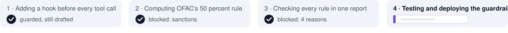

# 4 · Testing and deploying the guardrail



> **You can stay in JupyterLab.**
>
> Everything needed to run this step is in notebook 1.4, including what to do if a cell fails. This
> page adds background.

So far, the guard has worked when the agent was asked politely. A guardrail also has to hold when a
script calls the tool directly, when the request applies pressure, when Neptune is down, and when the
agent runs in production. In this step, we'll test the guard in each of these situations, and then
deploy it and send the original request again. This step takes about 12 minutes.

## The question

Before testing the hook, it's worth asking why we need one at all, when there are two simpler places
to put the check.

| Option | What it gives you | What it costs |
|---|---|---|
| **A · An instruction in the prompt**: "always call `check_supplier` first" | no new code | the model decides whether to follow it; other agents never read it |
| **B · A check tool** the model can call | the report, on demand | the model decides whether, and when, to call it |
| **C · Your hook** | runs before the action, whatever the model decides | a hook to write and deploy |

> **Think before you look.**
>
> When the PO tool is called directly, as a script or another agent would call it, which of the three
> agents draft the PO? Decide before running the cells.

## Run it

Open **`1.4 - Testing and deploying the guardrail.ipynb`**, and run **Cell 4.0 · Connect** first. It connects
this notebook's kernel and shows where the order stands so far. Then:

1. Run **Cell 4.1 · Prompt, tool or hook**, and then **Cell 4.2 · Ask under pressure**.
2. Run **Cell 4.3 · Neptune is down**.
3. Run **Cell 4.4 · Deploy and resend**. The deploy takes a few minutes. The cell then sends the
   original request, word for word, followed by a follow-up of the kind procurement would send.

## What the cells ran

Cells 4.1 and 4.2 build three agents with the same model and tools, each with one difference.

```python
agents = {
    "A · prompt instruction":    build_agent(extra_tools=[check_supplier], extra_prompt=ALWAYS_CHECK),
    "B · verification tool":     build_agent(extra_tools=[check_supplier]),
    "C · before-tool-call hook": build_agent(guard=NeptuneGuardPlugin(rules=reload(guard_rules))),
}
for name, a in agents.items():
    result = a.tool.draft_purchase_order(record_direct_tool_call=False, **PO)   # called directly
```

Cell 4.3 makes the report raise, as if Neptune were unreachable. Cell 4.4 packages the agent with your
hook (`neptune_guard.py`), `guard_rules.py` and the queries, and runs it on Amazon Bedrock AgentCore
Runtime inside the workshop VPC, next to Neptune. When the hook blocks, the agent calls
`recommend_alternatives`, which returns compliant suppliers with the warehouses that carry the
product, nearest first, with stock read from DynamoDB.

## What we found

### Only the hook checks a direct call

When the tool is called directly, no model is involved, so nothing can choose to run a check. Agents
A and B both draft the PO, and only agent C, with the hook in the action's path, blocks it.

### When the model is asked, the model decides

For agents A and B, the model decides whether to check, and it can decide differently on the next
run, or after a change to the prompt. Agent C checks every time, because the hook makes that
decision rather than the model.

### The guard fails closed

When Neptune is unreachable, even a clean order is blocked, because an action that can't be checked
doesn't go through.

### The same request has the opposite outcome in production

The deployed agent blocks the PO with the four reasons and suggests AnyCompany Supply Co. The
follow-up order goes through, because the hook checks the new supplier in the same way.

### Another agent is held to the same guard

In practice, other agents call the same actions. The notebook `3 - Run it from Kiro (optional).ipynb`
serves your files as an MCP server, and Kiro, an AI agent that never reads the procurement agent's
prompt, places orders through it. Kiro's model chooses the tool calls, and your hook decides what
happens. The session closes with this demo, and you can try it yourself from **Finished early?**

> **In your system.**
>
> Test the guard in the ways it will be attacked, by calling the tools directly, putting pressure on the
> model, and taking the graph away. Make sure it fails closed. Deploy the guard with the tools rather
> than with one agent's prompt, so that every caller goes through it, and when it blocks, hand back a
> next step.

> **Check.**
>
> Cell 4.1 shows **PO drafted** for A and B and **BLOCKED** for C, and Cell 4.4 shows
> `[BLOCKED] draft_purchase_order(...)` for AnyCompany Components, then `[ok]` for AnyCompany Supply
> Co. Go to **Wrap-up**.

<details>
<summary>Cell 4.2 ran long, or the deploy failed?</summary>

If Cell 4.2 runs for more than 2 minutes, choose **Interrupt**, because the result that matters is the
one from Cell 4.1. If the deploy fails, run Cell 4.4 again, because it updates the same runtime. After
a kernel restart, run **Cell 4.0 · Connect** again first.

</details>
